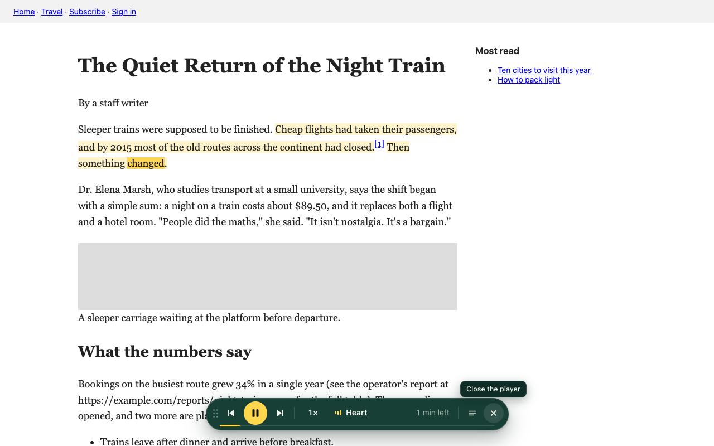

# Lector

A Chrome extension that reads web pages aloud in a natural voice, and
highlights each word as it is spoken.

The voice runs on your own computer. There is no account, no server and no
limit, and nothing you read leaves the browser.



## What it does

- **Reads any article.** Press `Alt+R`, click the toolbar button, or use the
  Listen tab on the edge of the page. Menus, sidebars, adverts and footers are
  left out.
- **Highlights as it reads.** The sentence is tinted and the word being spoken
  is marked, timed from the voice model itself rather than estimated.
- **Follows along.** The page scrolls with the voice, and stops following the
  moment you scroll yourself.
- **Starts anywhere.** Hover a paragraph for a play button, select text and
  press Listen, or right-click and choose "Read aloud from here".
- **Floating player.** Play and pause, previous and next sentence, speed from
  0.5× to 4×, fifteen voices with previews, and quick options. Drag it wherever
  you like.
- **PDFs.** Opens them in its own view, rebuilds paragraphs from the page
  layout, and skips running headers and page numbers.
- **Google Docs.** Opens the document as a clean page of text and reads that.
- **Remembers your place.** Come back to a long article and it carries on
  where you stopped.
- **Leaves things out when you ask.** Citation markers, web addresses, image
  captions, code blocks, and optionally anything in brackets.

## Install

Lector is not in the Chrome Web Store. To run it from source:

```bash
npm install
npm run build
```

Then open `chrome://extensions`, turn on **Developer mode**, choose
**Load unpacked** and pick the `dist` folder.

The first time you press play, Lector downloads the voice model (about
330 MB, or 90 MB on machines without WebGPU). After that it works offline.

## Shortcuts

| Keys | What happens |
| --- | --- |
| `Alt+R` | Play or pause. Starts reading the page if nothing is playing. |
| `Alt+Shift+R` | Read the selected text. |
| `Alt+.` and `Alt+,` | Next and previous sentence. Add `Shift` for paragraphs. |
| `Alt+=` and `Alt+-` | Faster and slower. |

On a Mac, `Alt` is the Option key. The first two can be changed at
`chrome://extensions/shortcuts`.

## How it works

```
 page (content script)            service worker            offscreen document
 ───────────────────────          ──────────────            ─────────────────────────
 find the article text    ──────► start the engine  ──────► worker: Kokoro voice model
 split into sentences                                        (WebGPU, or WebAssembly)
 send sentences           ─────────────────────────────────► audio element plays speech
 highlight + scroll       ◄───────────────────────────────── clock + word start times
```

- **Finding the text.** Paragraphs vote for the container they sit in; the
  container with the most paragraph text is the article. Every character keeps
  a link back to its place in the page (`src/content/blocks.ts`).
- **Speaking.** Sentences go to an offscreen document, which runs
  [Kokoro](https://huggingface.co/hexgrad/Kokoro-82M) in a worker and plays the
  result. A few sentences are always prepared ahead (`src/offscreen/`).
- **Word timing.** The model reports how long each phoneme lasts. Those
  durations are matched back to the words of the sentence, including the awkward
  cases where the phonemiser merges words or expands a number into several
  (`src/offscreen/align.ts`).
- **Highlighting.** The CSS Custom Highlight API colours ranges of text without
  changing the page's HTML (`src/content/highlight.ts`).

A longer walkthrough with diagrams is in [docs/how-it-works.html](docs/how-it-works.html).

## Privacy

- Text is turned into speech on your machine. It is not sent to any server.
- The only network request Lector makes is the one-time download of the voice
  model from Hugging Face.
- Settings and reading positions are stored locally in the browser.

## Limits

- English only. The voices are American and British English.
- Scanned PDFs with no text layer cannot be read.
- Google Docs are read in a separate clean view, not inside the editor.
- Without WebGPU the voice runs on WebAssembly, which is slower than real time
  on many machines, so playback pauses between sentences.
- Above roughly 2.5× the voice is sped up by the browser and loses some
  clarity.

## Development

```bash
npm run watch        # rebuild on change
npm run typecheck
npm test             # drives the built extension in Chromium on test pages
node scripts/try.mjs https://example.com/some-article   # try it on a real page
node scripts/voice-check.mjs    # speak, transcribe back, and measure speed
```

The tests use the Chromium that Playwright installs
(`npx playwright install chromium`), or the one named by `CHROMIUM_PATH`.

## Licence

MIT. Third-party code and the voice model have their own licences, listed in
[NOTICE.md](NOTICE.md).

Inspired by read-aloud tools.
